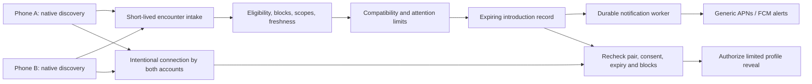

# Follow-up research: competitors, distinctiveness, and system options

Research date: October 25, 2026 (America/Toronto).

Scope: follow-up source research and implementation/system-design **possibilities**. No framework selection, implementation plan, app code, dependency installation, deployment, or environment-configuration change was made in this task. This supplements the [first report](proximity-dating-research.md), particularly where previously inaccessible sources are now available.

## 1. Direct answer about novelty

**The follow-up found a close precedent, so I would not claim that proximity plus required in-person interaction is a new niche.** A public project called **Near** describes compatible-person proximity matching, no swiping, no pre-meeting chat, and chat unlocking only after both people arrive at a nearby meeting spot. Its author claims a Stanford live pilot; deployment, adoption and performance were not independently verified. [R22]

Your **specific bundle** below has not been verified in an exact duplicate, but that is different from proving novelty. In particular, Near gates chat; its published nearby-screen screenshot shows photos, names, ages and compatibility cards before any depicted meetup. That suggests a different identity-reveal experience from your proposed hidden-profile gate, but screenshots may be mockups or older versions. It is not evidence that your rule is exclusive. [R22]

The combination being compared is:

1. Automatic, bilateral eligibility/compatibility matching without a profile-selection feed.
2. An introduction triggered by a current nearby encounter during everyday activity.
3. Profiles hidden until both people intentionally connect in person.
4. Minimal phone use, user-controlled discovery scopes, and no retained GPS trail as a product goal.

Here, “forced in-person” means **the product gates profile access behind a voluntary in-person connection**. It does not mean people must respond, talk, exchange numbers, or surrender control of their phones. A technical handshake can establish an authorized account pair and some proximity evidence; it cannot prove a voluntary conversation occurred.

The strongest positioning supported so far is:

> We are exploring automatic nearby introductions where profiles unlock only after a mutual in-person connection, with minimal phone use and minimal location retention. Close precedents combine proximity and meeting-gated chat; our proposed distinction is the exact identity-reveal, consent and privacy experience.

The concept is differentiated from conventional swipe apps, but **relative novelty within proximity/IRL dating remains unestablished**, especially after finding Near. Avoid “first,” “only,” “nobody does this,” or a patent-novelty claim on the present evidence.

### What weakens a broad novelty claim

- **Proximity plus an in-person gate is publicly described:** Near is a close developer-documented example, with the verification limits above. [R22]
- **Proximity dating already exists:** happn explicitly documents geographic crossed-path discovery. [R1–R2]
- **Making the product lead to an in-person date already exists:** Breeze removes the ordinary pre-date chat flow and arranges dates. [R3]
- **Venue presence and routine-place discovery already exist:** Bumpti documents shared places, venue check-ins, and people currently there. [R4]
- **Anti-swiping and interaction constraints already exist:** FROM organizes date proposals and restricts ordinary chat to a date-related window; Keeny replaces swiping with a feed. These are different constraints from ours, but show that “not another swipe app” is not unique. [R5–R6]
- The first report identified older ambient-discovery and Bluetooth social-introduction leads. This follow-up also found Mobuds, whose author describes an older Bluetooth chat/dating project with criteria-based proximity alerts. Its historical date and patent assertions were not independently verified. Unsuccessful, prototype, or discontinued projects still matter to an originality investigation. [R25]

## 2. Research method, skills, and limits

Installed skill discovery found only `cloud-environment-onboarding:setup`; there was no installed competitor-research or system-design skill. I then located Expo's **official public skills repository** and consulted its overview and native-module skill, plus lifecycle/config-plugin references, as research material for a possible Expo/React Native approach. They were not installed or used to scaffold an application. Their implementation workflows do not change the user's research-only scope. [R14]

Primary sources included developer-authored Google Play listings, happn's privacy policy, Breeze's website/FAQ, Apple/Android/Google platform documentation, official and maintainer GitHub repositories, and an accessible reciprocal-recommendation paper.

Google Play searches included:

- `proximity dating`, `bluetooth dating`, `IRL dating`, `bump dating`;
- `no swipe meet in person dating`, `encounter dating nearby`, `meet before matching`;
- `nearby match notification`, `meet in person unlock profiles`;
- `real life dating no swiping`, `proximity bluetooth singles`.

Google Play candidate descriptions were inspected for six dating products: happn, Breeze, Bumpti, FROM, Keeny, and Tinder. A similarly named Bump Connect listing was also inspected and excluded from the dating comparison because its description concerns creators/content/community. A search result or product name was not treated as evidence of its features. [R7]

GitHub repository searches for `bluetooth dating`, `proximity dating`, and `dating "in person" unlock` then surfaced closer developer-described projects. Near, KnowMe, Proximity, Mobuds, and a VolHacks proximity-dating repository were inspected. Near changed the novelty conclusion materially. Selected public Proximity source paths were also read statically, without running the code. Repository README/marketing claims were kept separate from executable code evidence and independent deployment evidence. [R22–R26]

**Limits:** general Google/Bing/DuckDuckGo search requests were blocked by the environment proxy; the attempted Apple App Store search URL returned 404. Google Play is a ranked, locale-sensitive discovery surface, not an exhaustive product database. The observed searches displayed US-English store context, so they do not establish availability in Waterloo, Toronto, or Canada. Small iOS-only apps, web-only products, private pilots, regional products, discontinued services, and unadvertised features can be missed. Listings describe intended behavior, not tested reliability, privacy compliance, or audited backend implementations. No accounts were created and no apps were installed or device-tested.

These limits are precisely why the result cannot establish a universal negative about competitors.

## 3. What other dating apps and projects document

### Near: the closest verified description found

The public README says **“No swiping. No pre-meeting chat”** and describes this flow:

`walk near a compatible person → short bilateral acceptance window → choose a nearby meeting spot → both travel there → chat unlocks when both are detected there`

It lists compatibility scoring from lifestyle tags/profile prompts/daily questions, proximity notifications, mutual-match and meetup-confirmed notifications, campus verification, blocking/reporting, and meeting-location voting. Its listed stack is **React Native + Expo / Expo Router, Zustand, Express/Node.js, Firestore, Firebase Auth/Storage, Expo Push through EAS, and Google Cloud Vision SafeSearch**. These are author-reported components; application source is private. [R22]

What this means:

- The high-level product combination of proximity, compatibility, no swiping, and meeting-gated communication has a close public precedent.
- A complete Node.js/React Native-oriented implementation is plausible as a reported stack, but that report does not validate locked-phone detection, latency or battery use.
- Near does not disclose enough to establish whether detection is BLE, coordinates, another sensor path, or some hybrid. Do not fill that gap from the stack.
- “Exact coordinates never exposed to other users” is its stated privacy property. That is **not** the same as no coordinate collection or no backend location history.
- Its published nearby-screen screenshot shows recognizable profile cards, a discoverable state with a **2-mile radius**, and per-card countdowns. This provides visual evidence of a broader-area, visible-candidate experience in the depicted version, rather than proving same-queue detection or hidden identity. Screenshots may be mockups or stale; no live flow was tested. Your profile-unlock rule, immediate same-queue interaction rather than a selected meetup spot, and stronger data-minimization goal may differ.
- The live Stanford pilot is a self-report. No participant, app-store listing, operating company, performance result or historical priority was independently verified in this session.

| Dimension | Near's public material | This app's intended experience |
| --- | --- | --- |
| Matching interaction | No swiping; short mutual-accept window; screenshot has visible nearby cards. | No human candidate selection; deliberate connection consent is still needed. |
| Encounter context | Nearby on campus, then choose a meeting spot; screenshot shows a 2-mile radius. | Ideally already beside one another, such as a shared coffee queue. |
| Digital gate | Chat unlocks after detected arrival. | Full profiles unlock after intentional in-person connection. |
| Identity visibility | Nearby screenshot displays face/name/age cards. | Hidden until connection, except any explicit face-preview option later chosen. |
| Location privacy | Claims coordinates are not exposed to other users; retention undisclosed. | Minimize collection/retention itself, not just display. |

This comparison is intended behavior versus author-published material, not a tested product comparison.

### Other close project evidence

**KnowMe:** its public legal/description repository claims nearby discovery within 50 m using BLE, Wi-Fi Direct and GPS, plus encounter history, profiles, mutual-match chat and video calls. The associated privacy policy explicitly lists those proximity/location inputs. This is another close proximity-dating claim, but no physical conversation/profile gate was found in inspected text. The source inspected is legal/marketing material, not working radio code, so cross-platform/background feasibility is unproven. [R23]

**Proximity — “Dating, but you have to find each other”:** a public web prototype describes nearby browsing/likes, revealing live location after a mutual match, and games before meeting. Static inspection of its FastAPI/SQLite backend finds coordinate-based Haversine distance filtering, a one-mile nearby search and a 30-minute activity cutoff. Its nearby response includes profile fields and distance. This verifies a **code-level broad-area discovery example**, not a working BLE/locked-phone system or physical profile gate. Landing-page waitlist/launch claims were not verified and are not adopted as facts. [R24]

**Mobuds:** the author's README describes Bluetooth mesh chat/profile discovery and criteria-based proximity alerts, claiming origins in 2006. **VolHacks proximity-dating:** the public repository identifies a HERE-based hackathon project and links its project page. These are historical/project leads, not evidence that either achieved today's desired mobile behavior or full product bundle. No patent/legal assertion or project-success claim is independently validated here. [R25–R26]

### Established/store-listed product comparisons

| Product | Proximity / discovery in inspected sources | How an introduction is selected | In-person requirement in the described flow | Difference from this vision |
| --- | --- | --- | --- | --- |
| **happn** | Regular geolocation and radius-based crossing points; profiles of crossed users appear. | Likes; a reciprocal like creates a Crush and enables chat. | Online profile viewing and matching precede a meeting. No physical profile-unlock gate described. | Shares proximity, but not automatic no-selection introductions or meeting-gated profile access. |
| **Bumpti** | Shared routine places, crossed places, maps, explicit venue entry, and people there now. | Profile browsing and mutual likes; chat can open before an event or planned visit. | No physical profile-unlock gate described. | Strong overlap with public-venue modes, but profiles/selection/chat are available before connection. |
| **Breeze** | Scheduled dates at partner venues, not a documented ambient nearby trigger. | Curated daily suggestions and user likes; mutual match leads to date planning. | Removes ordinary chat and organizes the first date. | Already strongly encourages IRL interaction, but people choose matches from visible profiles. |
| **FROM** | Local scheduled date proposal rather than a documented spontaneous encounter trigger. | A person proposes drink/time/place; recipient accepts, declines, or changes the plan. | Standard chat opens 24 hours before a date and remains open six hours after; premium advertises earlier chat. | Constrains chat and avoids endless swiping, but does not require an encounter to reveal profiles. |
| **Keeny** | Interest/lifestyle-filtered live feed; local and global connections. | People read posts and choose to reach out/send a Spark. | Online feed and messaging are part of the described flow. | “No swiping” still includes human discovery/selection; not passive automatic matchmaking. |
| **Tinder** | Nearby/global profiles and preference-based discovery. | Human selection/likes; match/chat features. | Online profiles and conversation precede meeting. | Useful conventional baseline, not evidence of the proposed encounter-gated experience. |

“Not described” means exactly that; it is not a claim that the operator has never tested such a feature. Product restrictions also may vary by tier, region, and version. [R1–R6, R8]

### happn: useful data-flow evidence, not just marketing

The now-accessible policy is marked **updated July 22, 2026**. It says:

- Geographical position is recorded and updated regularly when the feature is enabled.
- A crossing point is identified when two members' positions are within a certain radius.
- Geolocation consent can be withheld; users then supply a city for nearby suggestions.
- Search preferences include age/gender and member characteristics; suggested profiles also consider activity, position, and profile information.
- Its last geographical position is retained for **two months** and crossing points for **six months**, according to that policy.

This establishes a documented location-data approach quite different from “no movement history.” It does not reveal the database, precise radius, ingestion rate, ranking model, or current service topology. It is a policy claim rather than an independent implementation audit. [R2]

### Breeze: useful recommender and product evidence

Breeze's FAQ says recommendations estimate match probability using both profiles, preferences, and behavior; it also recommends people who already liked the recipient. This is public evidence for reciprocal signals and curation, not disclosure of model architecture or training data. Its ordinary flow removes chat after a match and moves to scheduling. This is a close precedent for using product constraints to get people to meet, even without spontaneous proximity. [R3]

### What is public about internal engineering

Tinder publishes **Scarlet**, a Kotlin/Java/Android WebSocket client, and **StateMachine**, a Kotlin/Swift state-machine library used by Scarlet. These illustrate lifecycle-aware connection/state tooling that is relevant to mobile systems. Their repositories do **not** establish Tinder's complete current backend or prove a particular database, ranking system, or deployment is in use today. [R15]

Attempts to read Tinder/Bumble engineering pages and AWS/Redis Tinder case-study pages were blocked. Consequently, this report does not invent “Tinder uses X, therefore we should use X” claims. A conventional dating flow can be reasoned about from behavior; its private architecture cannot be reverse-engineered from store copy alone.

## 4. The core systems-design distinction

Near provides a useful middle case: it documents short acceptance/meetup windows and an arrival-gated chat state, but not its underlying presence-detection mechanism. Our architecture should distinguish public product evidence from our own proposed implementation. [R22]

A conventional app can rank candidates over a broad area, show a feed, and let users respond later. This app must decide whether an introduction is still meaningful **during a short encounter window**.

That changes the emphasis from an endlessly fresh feed to:

- timely and trustworthy encounter evidence;
- bilateral eligibility and current discovery permission;
- scarce attention: avoiding multiple simultaneous or repeated introductions;
- expiry and cancellation;
- coordinated, best-effort alerts;
- secure identity reveal after the intended people connect.

A large recommendation engine cannot compensate for discovering the other phone after the people have left.

## 5. Discovery architectures worth comparing

These are alternatives for discussion, not a selected architecture or build sequence.

| Option | Mechanism | Advantages | Costs / unresolved issues | Fit |
| --- | --- | --- | --- | --- |
| **A. BLE encounter, server eligibility/matching** | Phones detect/exchange opaque encounter material through a supported native radio path; server resolves eligible pairs. | Could avoid GPS entirely; server can enforce blocks, preferences, rate limits, and profile gating. | Background phone-to-phone discovery is the key uncertainty; server can learn an encounter graph. iOS advertising constraints make arbitrary-token broadcasts an unsafe assumption. | Closest conceptual fit, contingent on device evidence. |
| **B. Coarse geographic candidates plus local confirmation** | A short-lived area index finds candidates; radio or explicit connection confirms a nearby pair. | Reduces the search space; can use mature geographic indexing. | Adds location collection, boundary effects, permission/battery considerations, and still needs timely local confirmation. A coarse cell is not coffee-line proximity. | Possible compromise only if justified to users. |
| **C. Opt-in public venue/session** | A user joins a venue/session; server matches currently present users, potentially with local confirmation. | Concentrates users; can limit early exposure to public contexts. | Manual activation; check-in can be spoofed/stale; venue membership is sensitive and does not prove adjacency. Beacons require venue infrastructure and OS-specific validation. | Aligns with the chosen public-setting pilot, but tests a narrower experience. |
| **D. Mostly on-device private matching** | Devices use cached eligibility data or a privacy-preserving protocol to determine compatibility. | Potentially reduces centralized encounter knowledge. | Protecting sensitive preferences, enforcing blocks, preventing enumeration, maintaining freshness, and coping with mobile lifecycles are much harder. Exchanging cleartext preferences defeats the purpose. | Research direction; not a simple privacy toggle. |

H3, geohashes, and PostGIS-like spatial queries are **indexing tools**, not presence proofs. H3's published documentation describes hierarchical geographic cells. Nearby-cell queries need appropriate boundary handling and any necessary distance refinement. A coarse identifier can still identify a sensitive place in a sparse area. No particular spatial library is selected. [R19]

### Important correction to “just advertise rotating IDs”

Apple's current `CBPeripheralManager.startAdvertising` documentation supports local-name and service-UUID keys, describes advertising as best-effort, and says that in the background the local name is not advertised and all service UUIDs move into an overflow area discoverable only by iOS devices explicitly scanning for them. Its current scan API also requires explicit service UUIDs for background scanning. [R9]

Consequences for research:

- Do not assume a shared JavaScript API can put arbitrary token bytes into iPhone BLE advertisements.
- Do not assume an Android scanner sees an iPhone's background advertisement the same way another iPhone does.
- Randomly changing the service UUID can conflict with the need for a discoverable known service filter.
- A fixed app service followed by an authenticated GATT/token exchange is a candidate to examine, not a demonstrated workaround for every background limitation.
- Even rotating account aliases may leave **app membership** observable through a fixed service or recognizable radio pattern.

Android's background guidance documents filtered `PendingIntent` scanning to notify a process when a matching device is found, and discourages periodic scanning. Its companion-device APIs have association/filtering constraints that make “pair every stranger as a companion” an unjustified default. These mechanisms do not supply a cross-platform detection-time guarantee. [R10]

### Nearby Connections and UWB are separate possibilities

Google Nearby Connections provides discovery and data exchange, including Swift and Android APIs. Its connection guidance says both sides accept the connection and warns that unauthenticated connections are insecure. That technical acceptance can be implemented by app logic; it is not automatically evidence of human consent. Any app must still authorize the account pair and make the introduction deliberate. Discovery documentation is not a promise that arbitrary locked phones will find each other instantly. [R11]

Apple Nearby Interaction can provide distance/direction on supported UWB hardware after devices exchange discovery tokens. Current documentation describes foreground operation and specific background conditions, including a Live Activity route on supported versions. It does not make UWB a universal, zero-setup ambient scanner. Some current documentation also mentions newer OS features; availability must be checked against the actual deployed OS/device targets. [R12]

UWB could make an **optional, mutually enabled** closer/farther interaction more credible than raw Bluetooth signal strength. It still needs discovery, session setup, device support, consent, and abuse analysis. It cannot rescue a universal background-discovery promise by itself.

## 6. A candidate end-to-end architecture

This diagram is a discussion model for option A or a venue-assisted variant. The radio path remains a feasibility condition, not a solved component.

The server may identify the accounts to enforce rules while the clients remain unaware of the other identity until the reveal gate. That protects users **from premature client disclosure**, not from the service operator learning who encountered whom. A stronger operator-privacy claim would require a different design and analysis.

### Candidate components

A **TypeScript/Node.js modular monolith**, with one primary transactional database and a notification worker, is a reasonable baseline to compare against managed alternatives. This is a complexity judgment for a small pilot, not a claim about any operator's private topology. npm fits the user's preference. Near's reported Express/Firestore/Firebase stack is a concrete managed-service alternative to examine: it can support account state and workflows, but does not disclose how atomic pair reservations, stale presence or radio detection are handled. [R22]

| Logical component | Responsibility | Important boundary |
| --- | --- | --- |
| Account/profile/preferences | Adult eligibility, account status, profile, bilateral preferences. | Pre-connection endpoints must not return another person's hidden profile. |
| Discovery policy | Pause, public/selected-place scope, session expiry, notification preferences. | Stale device state must not silently override a current pause or block. |
| Encounter intake | Validate opaque material, freshness and duplicate observations. | A client claim is not trusted physical evidence; no public token-to-profile lookup. |
| Match broker | Apply bilateral eligibility, compatibility threshold, repeat-pair and attention caps. | May abstain; should not create low-quality introductions just to appear active. |
| Introduction state | Coordinate the pair, expiry, cancellation, connection and reveal. | Authoritative server state, not two independent notification booleans. |
| Notification worker | Retry safely and send expiry-aware generic alerts. | Provider acceptance is not proof of phone display or human awareness. |
| Connection/reveal gate | Authenticate both accounts and pair-bound confirmation. | A nearby radio signal, copied symbol, or QR scan alone must not reveal profiles. |
| Reporting/moderation | Blocks, abuse reports and justified evidence retention. | Do not create a permanent encounter history merely for convenient analytics. |

A PostgreSQL-like transactional store is suitable to investigate because pair/user reservations, introduction creation, and a notification-outbox record can be committed consistently. PostgreSQL documents isolation/locking tools, but the actual transaction pattern would still need design and testing. An optional Redis-like cache can hold short-lived indexes, but cache TTL alone is neither authorization nor a deletion guarantee. [R18]

Managed services could reduce operational work for auth, object storage, queues and push. They do not solve radio discovery, introduce zero latency, or remove the need for authorization, transaction semantics, retention controls, and processor-region review. A microservice fleet, Kafka, a vector database, or GPU ranking is not a demonstrated prerequisite for a Waterloo public-venue pilot.

### State and concurrency

One conceptual flow is:

`candidate → offered → connected by both → revealed`

An offer may instead expire, be dismissed, or be cancelled from any relevant state. Alert delivery is a side effect with its own status, not the definition of being connected.

Design questions include canonical pair IDs, idempotency for repeat observations/retries, atomic reservations so one person is not offered conflicting introductions, and policy-version checks when pause/block/preferences change. Commit an introduction and an outbox job together; then a worker can retry without silently losing the notification between two writes. This pattern provides retryable processing, **not exactly-once human notification**.

Recheck authorization at connection and every profile read. A notification or signed token issued earlier should not bypass a new block. An already viewed image or screenshot cannot be recalled, which is a separate limit to explain honestly.

### Data and retention

Keep long-lived account data separate from short-lived encounter aliases, observations and pending introductions. Separate any justified safety-case records again, with a reason and retention policy. IP logs, analytics, crash reports, worker traces, backups, and media URLs all count when assessing retention and identity leakage.

Encrypted media or a hidden UI is insufficient if a pre-connection response already contains the profile/photo. The profile endpoint and media authorization must enforce the gate. Short-lived media access can reduce exposure; it cannot stop an authorized recipient from recording what they see.

No retention duration is chosen here. Discovery data should have a stated purpose and finite lifetime; security/reporting records may need a different policy. “Everything expires from Redis” is not a complete data-lifecycle design.

## 7. Notification delivery and the coffee-line deadline

Approximate latency is:

`radio detection + OS wake/scheduling + network + policy/matching + notification delivery`

Optimizing a database query will not eliminate radio/OS delays. Both parties' contexts differ, so exact simultaneous delivery is not a credible promise.

Apple describes APNs as best-effort, with possible reordering/storage. Its documentation provides expiration/collapse controls; expiration zero is not an absolute delivery-deadline guarantee. Its background-notification guide explicitly says silent pushes are not guaranteed and may be throttled. A design cannot use frequent silent pushes as a reliable Bluetooth wakeup mechanism. [R16]

FCM's Admin SDK exposes Android TTL and collapse controls. They help reduce stale/duplicate notifications but do not establish when a person saw them. Notification payloads should carry a generic introduction reference, not the hidden person's face, name, preferences, or location. [R17]

After an alert is opened, the app should retrieve current server state and handle expiry or cancellation. Immediate deletion/retraction of an already displayed notification on an offline phone cannot be guaranteed. A stale alert must not authorize a reveal or assert that the other person is still nearby.

## 8. Matching/recommendation design possibilities

Public product evidence supports separating **candidate generation**, **bilateral eligibility**, and **ranking**. happn generates candidates from crossings/preferences; Breeze describes profile/preferences/behavior signals and previous likes. Neither provides a transferable proprietary algorithm. [R2–R3]

A later system could represent eligible nearby users as a graph: an edge exists only if both people qualify and both are available. Ranking chooses an introduction opportunity, subject to attention caps and the ability to abstain. It should not assume all users fall into two gender partitions; mutual preferences define the graph.

| Approach | What it offers | Main limitation |
| --- | --- | --- |
| Explicit rules/weighted questionnaire | Explainability and a cold-start baseline without behavioral history. | Weights/thresholds are hypotheses, not scientifically calibrated chemistry. |
| Reciprocal learned model | Estimates interest in both directions rather than A's interest alone. | Needs appropriate outcomes/data, calibration, abuse controls and fairness analysis. |
| Constrained graph allocation | Limits repeated/popular-user overload and conflicting introductions. | Dynamic arrival/expiry; waiting for an ideal global allocation can waste the encounter. |
| Rich embeddings/LLM features | May organize free-text interests. | Unproven chemistry prediction, sensitive inference, opacity and unnecessary data exposure. |

The accessible 2024 KDD paper **“Revisiting Reciprocal Recommender Systems: Metrics, Formulation, and Method”** argues that evaluating each side independently can misrepresent overall reciprocal matching. It studies overall coverage, bilateral stability, and balanced ranking, and evaluates recruitment and dating datasets. This is relevant algorithmic literature, not proof of better in-person chemistry or a production recommendation for this app. Its dating dataset uses opposite-sex Libimseti user ratings, treating mutual ratings of 8 or above as a successful match; it is not measured conversation quality or lasting relationships. Its evaluation setting and population therefore limit transfer to this inclusive, immediate no-feed product. [R20]

Useful outcomes would include mutual willingness to connect, successful authorized connection, comfort, unwanted approaches, reporting, and later satisfaction. Notification opens are a delivery/attention measure, not compatibility. Missing a notification is not a rejection label. Since this product intentionally removes swipe feedback, it will have less easy behavioral training data; any post-interaction feedback should be deliberate, minimal and optional where appropriate.

## 9. Mobile implementation options

| Option | Why consider it | What remains native / difficult |
| --- | --- | --- |
| **React Native/TypeScript, potentially Expo development builds** | Shared UI/product logic; npm ecosystem; compatible with a Node.js backend. | Swift/Kotlin radio integration, lifecycle restoration, permissions/configuration, signing, physical-device validation. Expo Go is not sufficient for arbitrary native libraries. |
| **Native Swift + Kotlin** | Direct platform APIs and debugging of the riskiest radio/lifecycle behavior. | More duplicate UI/domain integration work and specialist knowledge. Still subject to identical OS limits. |
| **Android-only initial client** | Easier local build environment for a Linux/Node-oriented project; narrower device pairing scope. | Android vendor power policies; excludes iPhone encounters and says little about cross-platform feasibility. |
| **Web/PWA as primary client** | Easy deployment and shared web skills. | Not a credible basis here for arbitrary, passive, locked-phone Bluetooth discovery on both target platforms. Could support ancillary account/admin functions. |

React Native's official material establishes native UI and extension mechanisms; Expo's development-build documentation describes builds with custom native libraries/configuration. Its native-module skill covers Swift/Kotlin/TypeScript bridges, lifecycle hooks and configuration plugins. **Those hooks integrate with OS behavior; they do not grant unlimited background runtime.** [R13–R14]

A concrete library trap: `react-native-ble-plx` supports central/client tasks such as scanning and reading characteristics, but explicitly lists phone-to-phone BLE/peripheral support among unsupported features. It also says it cannot run inside Expo Go because it requires custom native code. It therefore cannot be assumed to implement this full product by installation alone. [R21]

No mobile framework is selected. The radio/lifecycle findings should drive that later choice rather than a desire to keep every line in JavaScript.

## 10. In-person connection and recognition

A candidate connection should bind **the two authenticated accounts, the current introduction, freshness and both people's deliberate confirmation**. This is separate from initial discovery.

- **Bring phones together:** a good interaction reference, but NameDrop is not verified as an app-to-app dating-profile API. A supported local transport and explicit account/pair authorization are still needed.
- **QR or short code:** a plausible cross-platform confirmation mechanism, but screenshots, guessing, relay, replay and accidental pairing require analysis. QR proximity is social context, not cryptographic distance proof.
- **Shared symbol or keyword:** useful recognition/icebreaking ideas, not secrets strong enough to authorize profile access by themselves.
- **Face preview:** might improve recognition but explicitly reveals identity before the gate; this remains a product exception to decide.
- **Hotter/colder haptics:** raw BLE signal is too noisy to assume reliable distance/direction; UWB may offer a narrower supported-device alternative. Either can assist following/triangulation, so the mode needs bilateral opt-in, limits and easy exit.

No system can guarantee a real conversation, mutual comfort, or truthful confirmation by two people. The product can encourage meeting and require a joint connection action before reveal. It should not claim to verify human interaction beyond its actual evidence.

## 11. Conclusions for the next discussion

- **Near is a close precedent** for proximity plus compatibility plus meeting-gated communication. The specific hidden-profile/minimal-data encounter flow may differ, but uniqueness within the niche is not established. No exact duplicate was verified, and that is an inconclusive search outcome rather than a novelty finding.
- Option A best matches the no-GPS ambition conceptually, but ordinary background phone-to-phone discovery is the gating uncertainty. Option C can support public-setting research while testing a narrower experience. Neither is selected.
- A small transactional backend with explicit expiring introduction state is a reasonable system option; a sophisticated recommender or distributed service fleet is not the first unresolved problem.
- React Native/Expo remains plausible for shared product code, with unavoidable native work; common BLE package support is not enough.
- The intended timing needs definition: a sustained shared queue is a substantially different requirement from two strangers passing for two seconds.
- Before claiming universal reach, later device work must distinguish Android–Android, iPhone–iPhone, and mixed pairings under lock, low power, process death, permission changes and connectivity loss. No such experiments were performed in this research task.

No architecture, recognition mechanism, geographic retention policy, model, platform, or implementation sequence was finalized.

## Sources and evidence status

Sources below were retrieved during this follow-up. Some links are mutable; dates in product listings/policies are publisher supplied. Stored working text is under `/workspace/research-sources/`, outside the application checkout. Relevant sections were inspected; no software behavior was reproduced.

- **R1 — happn Google Play description:** https://play.google.com/store/apps/details?id=com.ftw_and_co.happn&hl=en — inspected; listing states updated October 21, 2026. Supports visible profiles, likes, Crush and chat flow.
- **R2 — happn privacy policy:** https://support.happn.fr/hc/en-us/p/privacy — inspected definitions, collection, recommendation and retention sections; marked July 22, 2026. Supersedes the first report's inability to retrieve this policy.
- **R3 — Breeze:** https://breeze.social/faq and https://play.google.com/store/apps/details?id=social.breeze.breeze_app&hl=en — inspected; FAQ source was obtained in the first pass and re-examined; store description retrieved in this follow-up. Product/recommendation claims are not independent audits.
- **R4 — Bumpti:** https://play.google.com/store/apps/details?id=com.bumpti&hl=en — inspected description; listing states updated October 24, 2026. Supports venue/check-in/profile/like flow, not its backend implementation.
- **R5 — FROM:** https://play.google.com/store/apps/details?id=com.nik.frome&hl=en — inspected description; listing states updated July 21, 2025. Timing/paywall features are publisher claims, not tested.
- **R6 — Keeny:** https://play.google.com/store/apps/details?id=com.ours.android&hl=en — inspected description; listing states updated October 22, 2026.
- **R7 — Google Play searches:** https://play.google.com/store/search?q=proximity%20dating&c=apps ; https://play.google.com/store/search?q=bluetooth%20dating&c=apps ; https://play.google.com/store/search?q=meet%20in%20person%20unlock%20profiles&c=apps — representative inspected result pages; additional exact queries recorded in section 2. Candidate exclusion: https://play.google.com/store/apps/details?id=com.bumpsocial&hl=en . Search results are not a complete market census.
- **R8 — Tinder:** https://play.google.com/store/apps/details?id=com.tinder&hl=en — inspected description; listing states updated October 19, 2026. Supports conventional preference/profile/like/chat flow, not backend stack claims.
- **R9 — Current Apple Core Bluetooth APIs:** https://developer.apple.com/documentation/corebluetooth/cbperipheralmanager/startadvertising(_:).md and https://developer.apple.com/documentation/corebluetooth/cbcentralmanager/scanforperipherals(withservices:options:).md — inspected advertising keys, overflow/background behavior and scan filtering. Stronger than relying only on the archived guide from the first pass.
- **R10 — Android background BLE:** https://developer.android.com/develop/connectivity/bluetooth/ble/background — relevant documented mechanisms re-examined from the first pass; no device validation.
- **R11 — Nearby Connections:** https://developers.google.com/nearby/connections/android/manage-connections and https://developers.google.com/nearby/connections/swift/discover-devices — inspected acceptance/authentication and advertising/discovery documentation; overview also available in first report.
- **R12 — Nearby Interaction:** https://developer.apple.com/documentation/nearbyinteraction.md — inspected overview/background section; not all mentioned OS features should be assumed deployed to target phones. Related sample: https://developer.apple.com/documentation/nearbyinteraction/implementing-interactions-between-users-in-close-proximity.md .
- **R13 — React Native / Expo development builds:** https://github.com/facebook/react-native and https://github.com/expo/expo/blob/main/docs/pages/develop/development-builds/introduction.mdx — inspected official descriptions of native/shared code and development builds.
- **R14 — Official Expo skills consulted as research references:** https://github.com/expo/skills ; https://github.com/expo/skills/blob/main/plugins/expo/skills/expo-overview/SKILL.md ; https://github.com/expo/skills/blob/main/plugins/expo/skills/expo-module/SKILL.md ; native-module references https://github.com/expo/skills/blob/main/plugins/expo/skills/expo-module/references/lifecycle.md and https://github.com/expo/skills/blob/main/plugins/expo/skills/expo-module/references/config-plugin.md . Not installed; no scaffold/build workflow executed. No feedback or other message was sent to Expo.
- **R15 — Tinder engineering source:** https://github.com/Tinder/Scarlet and https://github.com/Tinder/StateMachine — inspected READMEs; public tooling evidence only, not a complete current production architecture.
- **R16 — Apple notifications:** https://developer.apple.com/documentation/usernotifications/sending-notification-requests-to-apns.md and https://developer.apple.com/documentation/usernotifications/pushing-background-updates-to-your-app.md — inspected delivery/expiration and silent-push limitations.
- **R17 — Firebase Admin Node SDK:** https://github.com/firebase/firebase-admin-node/blob/main/src/messaging/messaging-api.ts — inspected message interfaces and Android TTL/collapse documentation. SDK surface, not proof of delivery performance.
- **R18 — PostgreSQL concurrency documentation source:** https://github.com/postgres/postgres/blob/master/doc/src/sgml/mvcc.sgml — inspected concurrency/isolation/locking discussion as architectural background. No database was installed or transaction pattern benchmarked.
- **R19 — H3:** https://github.com/uber/h3 — inspected README describing hierarchical geospatial indexing; no location privacy or adjacency guarantee follows from using it.
- **R20 — Yang et al. (2024), “Revisiting Reciprocal Recommender Systems: Metrics, Formulation, and Method”:** https://arxiv.org/html/2408.09748v1 — inspected introduction, evaluation framing, method and experiment discussion; KDD DOI 10.1145/3637528.3671734. Results were not reproduced. An additional Crossref title search returned a **different** 2010 reciprocal-recommender short paper, DOI 10.1145/1864708.1864787; it was not misidentified as the separate RECON paper.
- **R21 — react-native-ble-plx:** https://github.com/dotintent/react-native-ble-plx — inspected explicit supported/unsupported list and Expo notes. A maintainer's documented limitation, not a comparison of every competing BLE package.

- **R22 — Near developer showcase:** https://github.com/leahchaku/near-showcase and https://raw.githubusercontent.com/leahchaku/near-showcase/main/README.md — inspected full README and all three published screenshots in `docs/` (`IMG_2249.PNG`, `IMG_2251.PNG`, `IMG_2252.PNG`), including the nearby-card screen and onboarding. Screenshots establish depicted UI, not deployed behavior; `docs/` does not supply implementation documentation. Strong evidence of a close **publicly described product flow**, with author-reported stack/pilot; no independent deployment or performance verification.
- **R23 — KnowMe developer legal/description repository:** https://github.com/georgebro/knowme-legal and https://github.com/georgebro/knowme-legal/blob/main/privacy-policy.html — inspected README and privacy text; policy marked July 29, 2026. Feature/sensor claims, not implementation or app-store verification.
- **R24 — Proximity public prototype:** https://github.com/osielsouls1-jpg/proximity ; inspected `frontend/index.html`, `frontend/app.html`, `frontend/game.html` and `backend/main.py`. The backend was read statically, not imported/executed. Supports concrete coordinate-based filtering and pre-meeting profile disclosure; no production/adoption/security validation.
- **R25 — Mobuds:** https://github.com/RobSmithDev/Mobuds — inspected author README describing Bluetooth mesh/proximity alerts and historical claims. Dates and patent assertions were not independently verified; no source execution or patent analysis performed.
- **R26 — Additional repository discovery:** https://github.com/search?q=proximity+dating&type=repositories ; https://github.com/search?q=bluetooth+dating&type=repositories ; https://github.com/search?q=dating+%22in+person%22+unlock&type=repositories . Inspected result text and candidate pages, including https://github.com/xenobardok/proximity-dating . A zero-result exact-query search is not evidence of absence.

**Remaining access/research gaps:** blocked general search engines and engineering/vendor pages; no complete Apple-store or historical-product search; no patent search; no verified Waterloo/Toronto market penetration; proprietary backend/model details not public in inspected sources. These gaps limit novelty and competitive claims, rather than invalidate the narrower documented comparisons.
